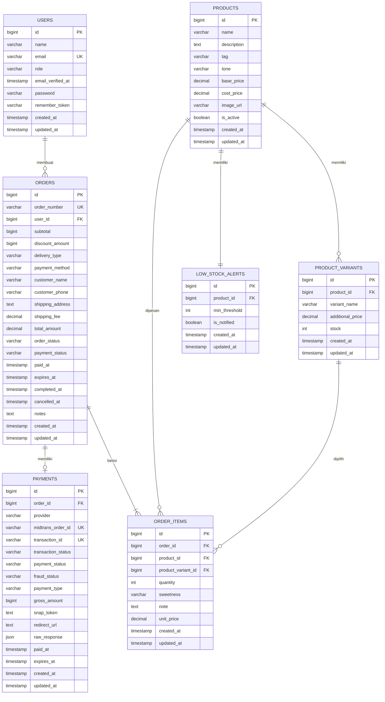

# Matcha and Me

Aplikasi pemesanan minuman matcha berbasis **Laravel 12 + Blade + Tailwind CSS v4**, dengan pembayaran online **Midtrans Snap** (QRIS dan Virtual Account) serta pembayaran **Tunai** yang dikonfirmasi manual oleh admin.

Aplikasi melayani dua peran:

- **Konsumen** — landing page, katalog, keranjang, checkout, pembayaran, dan riwayat pesanan.
- **Admin** — dashboard, produk & varian, stok, pesanan, pembayaran tunai, dan laporan penjualan harian.

README ini menjelaskan cara menjalankan aplikasi **tanpa Docker**: mulai dari clone/pull repository, instalasi dependency, konfigurasi database MySQL, migrasi, build frontend, konfigurasi Midtrans, sampai aplikasi tampil di browser.

---

## Daftar isi

1. [Fitur](#1-fitur)
2. [Teknologi](#2-teknologi)
3. [Prasyarat](#3-prasyarat)
4. [Clone dan update repository](#4-clone-dan-update-repository)
5. [Install dependency PHP](#5-install-dependency-php)
6. [Konfigurasi environment](#6-konfigurasi-environment)
7. [Membuat database MySQL](#7-membuat-database-mysql)
8. [Migrasi dan isi data demo](#8-migrasi-dan-isi-data-demo)
9. [Install dependency frontend dan build aset](#9-install-dependency-frontend-dan-build-aset)
10. [Menjalankan aplikasi](#10-menjalankan-aplikasi)
11. [Akun demo](#11-akun-demo)
12. [Alur pertama kali membuka aplikasi](#12-alur-pertama-kali-membuka-aplikasi)
13. [Integrasi pembayaran Midtrans](#13-integrasi-pembayaran-midtrans)
14. [Laporan penjualan](#14-laporan-penjualan)
15. [Testing](#15-testing)
16. [Troubleshooting](#16-troubleshooting)
17. [Struktur proyek](#17-struktur-proyek)
18. [Struktur database](#18-struktur-database)
19. [Opsional: menjalankan dengan Docker](#19-opsional-menjalankan-dengan-docker)
20. [Batasan dan catatan pengembangan](#20-batasan-dan-catatan-pengembangan)

---

## 1. Fitur

### Konsumen

- Registrasi, login, dan logout.
- Landing page, beranda, dan katalog menu dengan filter kategori.
- Detail produk: pilih varian ukuran, tingkat gula (`sweetness`), catatan, dan jumlah.
- Keranjang belanja berbasis session: tambah, ubah jumlah, hapus.
- Checkout sebagai tamu maupun pengguna yang login.
- Pilihan pesanan **Diantar** (ongkir flat Rp10.000) atau **Ambil sendiri**.
- Tiga metode pembayaran saat checkout:
  - **Tunai** — bayar di gerai atau saat pesanan diantar (COD).
  - **QRIS** — pembayaran online melalui Midtrans Snap.
  - **Transfer Bank** — Virtual Account melalui Midtrans Snap.
- Metode pembayaran terkunci setelah pesanan dibuat.
- Halaman pembayaran yang menampilkan status dan instruksi sesuai metode:
  - Tombol **Buka Pembayaran Midtrans** untuk QRIS/Transfer Bank.
  - Tombol **Buat Pembayaran** jika token Snap belum tersedia.
  - Instruksi bayar tunai untuk pesanan **Tunai**.
- Status pembayaran diperbarui otomatis lewat *polling* (3 detik untuk online, 5 detik untuk tunai) dan/atau webhook Midtrans.
- Riwayat pesanan menampilkan metode pembayaran, status pembayaran, dan tombol bayar ulang bila diperlukan.
- Tamu melihat riwayat yang tersimpan di session browser.

### Admin

- Dashboard ringkasan omzet hari ini, pesanan hari ini, pesanan diproses, pesanan selesai, dan peringatan stok menipis.
- Daftar pesanan dengan filter status dan pencarian nama/telepon/ID.
- Menampilkan **metode pembayaran** dan **status pembayaran** pada daftar pesanan.
- Mengubah status pesanan: `PROCESSING`, `COMPLETED`, `CANCELLED`.
- Menandai pesanan **Tunai** sebagai lunas (**Tandai Lunas**) setelah uang diterima.
- Guard: pesanan tidak dapat diselesaikan (`COMPLETED`) sebelum status pembayaran `PAID`.
- CRUD produk beserta varian dan stok per varian.
- Kategori (`tag`) dan tone ilustrasi produk diisi dari data seed.
- Halaman monitoring stok per produk/varian.
- **Laporan Penjualan harian**: omzet, jumlah transaksi, item terjual, rata-rata transaksi, grafik per jam, detail transaksi, dan menu terjual.
- Pesanan online yang melewati batas waktu otomatis dibatalkan oleh scheduler `orders:expire-unpaid` (berjalan tiap menit).

### Catatan scope

- Pembayaran online memakai **Midtrans Snap** mode sandbox: **QRIS** dan **Transfer Bank (Virtual Account)**.
- Pembayaran **Tunai** tidak memakai Midtrans dan dikonfirmasi manual oleh admin.
- Laporan yang tersedia adalah **laporan penjualan harian**, bukan laporan laba/rugi lengkap.
- Diskon member, notifikasi email/WhatsApp, manajemen user lanjutan, dan login Google **tidak termasuk** dalam aplikasi ini.

---

## 2. Teknologi

| Bagian | Teknologi |
|---|---|
| Backend | PHP 8.2+, Laravel 12 |
| Tampilan | Blade, Tailwind CSS v4, Bootstrap Icons (CDN) |
| Frontend build | Vite 7, Node.js 20.19+ / 22.12+ |
| Database | MySQL 8 / MariaDB |
| Auth | Session Laravel (`Auth::attempt`) |
| Keranjang | Session Laravel |
| Pembayaran | Midtrans Snap (`midtrans/midtrans-php`) |
| Testing | PHPUnit 11 (`php artisan test`) |

---

## 3. Prasyarat

Pastikan perangkat sudah memiliki:

1. **Git** — untuk clone dan update repository.
2. **PHP 8.2 atau lebih baru**.
3. **Composer 2**.
4. **Node.js 20.19+ atau 22.12+** dan npm.
5. **MySQL 8 / MariaDB** — bisa dari XAMPP, Laragon, atau instalasi MySQL mandiri.
6. **Akun Midtrans Sandbox** (opsional, hanya jika ingin menguji QRIS/Transfer Bank).

Cek versi yang terpasang:

```bash
git --version
php -v
composer -V
node -v
npm -v
```

Ekstensi PHP yang perlu aktif:

- `pdo_mysql`
- `mbstring`
- `openssl`
- `fileinfo`
- `ctype`
- `json`
- `tokenizer`
- `xml`
- `curl` (dibutuhkan Midtrans)
- `gd` (disarankan)
- `zip` (dibutuhkan Composer untuk beberapa paket)

### Jika memakai XAMPP (Windows)

1. Install XAMPP, lalu jalankan **Apache** dan **MySQL** dari XAMPP Control Panel.
2. Tambahkan folder PHP XAMPP ke `PATH`, misalnya `C:\xampp\php`, agar perintah `php` dan `composer` bisa dipakai dari terminal.
3. Buka `C:\xampp\php\php.ini`, pastikan baris berikut tidak diawali tanda `;`:

   ```ini
   extension=pdo_mysql
   extension=mbstring
   extension=openssl
   extension=fileinfo
   extension=curl
   extension=gd
   extension=zip
   ```

4. Tutup dan buka kembali terminal setelah mengubah `php.ini`.

### Jika memakai Laragon (Windows)

1. Jalankan Laragon dan start **MySQL**.
2. Gunakan terminal Laragon agar `php`, `composer`, dan `mysql` sudah tersedia di `PATH`.

---

## 4. Clone dan update repository

Bagian ini menjelaskan alur Git dari nol, termasuk cara mengambil update dan menyelesaikan konflik.

### 4.1 Clone pertama kali

Repository: `https://github.com/pploke/laravel-matcha`

**HTTPS (paling mudah):**

```bash
git clone https://github.com/pploke/laravel-matcha.git
cd laravel-matcha
```

**SSH (jika sudah memasang SSH key di GitHub):**

```bash
git clone git@github.com:pploke/laravel-matcha.git
cd laravel-matcha
```

**Clone ke folder dengan nama lain:**

```bash
git clone https://github.com/pploke/laravel-matcha.git matcha-app
cd matcha-app
```

Setelah clone, cek isi folder:

```bash
ls -la          # Linux/macOS
dir             # Windows
```

> Folder `public/images/menu` berisi sekitar **24 MB** gambar menu. Clone pertama bisa terasa lebih lama pada koneksi lambat. Folder `vendor/` dan `node_modules/` tidak ikut di-clone karena dibuat oleh Composer dan npm.

### 4.2 Melihat branch yang tersedia

```bash
git branch -a
```

Untuk berpindah branch:

```bash
git switch main
```

Jika branch belum ada di lokal:

```bash
git switch --track origin/main
```

### 4.3 Mengambil update dari GitHub (pull)

Gunakan langkah ini setiap kali ada perubahan baru di repository.

**Cara aman (disarankan):**

```bash
git status
git fetch --all --prune
git switch main
git pull origin main
```

**Jika repository memakai beberapa branch fitur:**

```bash
git fetch --all --prune
git switch <nama-branch>
git pull origin <nama-branch>
```

**Jika ingin riwayat commit tetap lurus (rebase):**

```bash
git pull --rebase origin main
```

Jika muncul konflik saat rebase:

```bash
git status
# selesaikan konflik pada file yang ditandai
git add <file-yang-konflik>
git rebase --continue
```

Untuk membatalkan rebase:

```bash
git rebase --abort
```

### 4.4 Jika ada perubahan lokal sebelum pull

Cek dulu file apa yang berubah:

```bash
git status
```

**Simpan perubahan sementara:**

```bash
git stash push -m "perubahan lokal"
git pull origin main
git stash pop
```

**Jika perubahan lokal tidak diperlukan:**

```bash
git restore <file>
```

> Hati-hati: `git restore` membuang perubahan pada file tersebut dan tidak bisa dibatalkan.

**Jika ingin membuang semua perubahan yang belum di-commit:**

```bash
git restore .
```

### 4.5 Jika terjadi merge conflict

Konflik muncul saat Git tidak bisa menggabungkan perubahan otomatis. Contohnya ketika dua orang mengubah baris yang sama pada file yang sama.

1. Lihat file yang konflik:

   ```bash
   git status
   ```

2. Buka file yang ditandai `both modified`, lalu cari penanda:

   ```text
   <<<<<<< HEAD
   versi kode lokal
   =======
   versi kode dari repository
   >>>>>>> origin/main
   ```

3. Pilih atau gabungkan kode yang benar, lalu hapus semua penanda `<<<<<<<`, `=======`, dan `>>>>>>>`.

4. Tandai sudah selesai:

   ```bash
   git add <file-yang-konflik>
   ```

5. Lanjutkan merge:

   ```bash
   git commit
   ```

6. Jika ingin membatalkan merge:

   ```bash
   git merge --abort
   ```

**Tips:** jangan memakai `git checkout --ours` atau `--theirs` secara membabi buta. Perintah itu mengambil satu sisi file secara utuh dan bisa menghapus fitur dari sisi lain.

### 4.6 Setelah pull, jalankan langkah wajib

Setiap kali kode berubah, dependency atau migrasi bisa ikut berubah:

```bash
composer install
npm install
php artisan migrate
npm run build
php artisan optimize:clear
```

Jika ada perubahan konfigurasi `.env`:

```bash
php artisan config:clear
```

Jika data demo ingin di-reset (hati-hati, menghapus data):

```bash
php artisan migrate:fresh --seed
```

### 4.7 Perintah Git yang sering dipakai

| Perintah | Fungsi |
|---|---|
| `git status` | Melihat file yang berubah dan status branch |
| `git branch -a` | Melihat semua branch lokal dan remote |
| `git switch <branch>` | Pindah branch |
| `git fetch --all --prune` | Mengambil informasi branch terbaru tanpa mengubah file |
| `git pull origin main` | Mengambil dan menggabungkan update |
| `git log --oneline -10` | Melihat 10 commit terakhir |
| `git diff` | Melihat perubahan yang belum di-stage |
| `git stash push -m "pesan"` | Menyimpan perubahan sementara |
| `git stash pop` | Mengembalikan perubahan sementara |
| `git restore <file>` | Membuang perubahan pada file |
| `git add <file>` | Menandai file untuk commit |
| `git commit -m "pesan"` | Menyimpan perubahan ke riwayat lokal |
| `git push origin <branch>` | Mengirim commit ke GitHub |

> Jangan commit file `.env`, `vendor/`, `node_modules/`, atau `public/build/`. File-file itu sudah diatur di `.gitignore`.

---

## 5. Install dependency PHP

Dari folder project:

```bash
composer install
```

Jika muncul error ekstensi PHP, aktifkan ekstensi pada bagian prasyarat, lalu ulangi perintah di atas.

Alternatif jalur cepat (install, copy `.env`, generate key, migrate, npm install, build):

```bash
composer run setup
```

> `composer run setup` menjalankan `php artisan migrate --force` **tanpa** `--seed`. Buat database terlebih dahulu dan sesuaikan `.env` sebelum memakainya, lalu jalankan `php artisan db:seed` jika ingin data demo.

---

## 6. Konfigurasi environment

Salin file contoh environment menjadi `.env`.

**Windows (Command Prompt / PowerShell):**

```bash
copy .env.example .env
```

**Linux / macOS:**

```bash
cp .env.example .env
```

Generate application key:

```bash
php artisan key:generate
```

### 6.1 Konfigurasi database

Secara bawaan, `.env.example` sudah dikonfigurasi untuk MySQL. Buka `.env`, lalu cocokkan bagian berikut:

```env
APP_NAME="Matcha and Me"
APP_URL=http://127.0.0.1:8000

DB_CONNECTION=mysql
DB_HOST=127.0.0.1
DB_PORT=3306
DB_DATABASE=laravel_matcha
DB_USERNAME=root
DB_PASSWORD=
```

Penjelasan:

- `DB_HOST=127.0.0.1` dipakai karena MySQL berjalan langsung di komputer, **bukan** di container Docker.
- Pada XAMPP/Laragon, user default biasanya `root` dengan password kosong. Jika MySQL memakai password, isi `DB_PASSWORD`.
- Nama database `laravel_matcha` hanya contoh; Anda boleh memakai nama lain selama nilainya sama dengan database yang dibuat pada langkah berikut.
- Biarkan `SESSION_DRIVER=database`, `CACHE_STORE=database`, dan `QUEUE_CONNECTION=database` seperti bawaan. Tabel pendukungnya dibuat otomatis oleh migrasi.

### 6.2 Konfigurasi Midtrans

Isi kredensial sandbox jika ingin menguji QRIS/Transfer Bank:

```env
MIDTRANS_MERCHANT_ID=G123456789
MIDTRANS_CLIENT_KEY=SB-Mid-client-xxxxxxxx
MIDTRANS_SERVER_KEY=SB-Mid-server-xxxxxxxx
MIDTRANS_IS_PRODUCTION=false
```

Penjelasan:

- `MIDTRANS_IS_PRODUCTION=false` memakai lingkungan **sandbox**.
- URL Snap dipilih otomatis dari `MIDTRANS_IS_PRODUCTION` di `config/services.php`.
- Jangan memakai Server Key produksi di lingkungan lokal.
- Jika nilai `.env` diubah, jalankan `php artisan config:clear`.

### 6.3 Timezone

Aplikasi memakai timezone `UTC` (`config/app.php`). Ini memengaruhi batas tanggal pada laporan penjualan dan waktu kedaluwarsa pembayaran.

Jika operasional memakai WIB, Anda dapat menambahkan:

```env
APP_TIMEZONE=Asia/Jakarta
```

lalu menyesuaikan `config/app.php` agar membaca `env('APP_TIMEZONE', 'UTC')`. Setelah itu jalankan `php artisan config:clear`.

---

## 7. Membuat database MySQL

### Cara 1: phpMyAdmin (paling mudah)

1. Buka `http://localhost/phpmyadmin`.
2. Klik **New** / **Baru**.
3. Isi nama database: `laravel_matcha`.
4. Pilih collation `utf8mb4_unicode_ci`.
5. Klik **Create**.

### Cara 2: terminal

Pastikan perintah `mysql` tersedia di `PATH`:

```bash
mysql -u root -p -e "CREATE DATABASE laravel_matcha CHARACTER SET utf8mb4 COLLATE utf8mb4_unicode_ci;"
```

Jika password root kosong, tekan Enter saat diminta password.

---

## 8. Migrasi dan isi data demo

```bash
php artisan migrate --seed
```

Perintah ini akan:

- Membuat seluruh tabel aplikasi, termasuk `payments` dan kolom pembayaran pada `orders`.
- Mengisi data demo:
  - **5 user** (1 admin, 4 konsumen)
  - **14 produk**
  - **42 varian** (14 produk × 3 ukuran)
  - **5 pesanan**
  - **3 baris pembayaran** Midtrans (pesanan tunai tidak membuat baris `payments`)

Jika ingin mengulang dari database kosong:

```bash
php artisan migrate:fresh --seed
```

> **Peringatan:** `migrate:fresh` menghapus seluruh tabel dan data di database yang dikonfigurasi. Jangan jalankan pada database yang berisi data penting.

> **Peringatan seeder:** `DatabaseSeeder` memakai `truncate()` untuk `payments`, `order_items`, `orders`, `low_stock_alerts`, `product_variants`, `products`, dan `users`. Menjalankan `php artisan db:seed` pada database yang sudah berisi data akan **menghapus data tersebut**. Backup terlebih dahulu.

Seeder memakai perintah khusus MySQL (`SET FOREIGN_KEY_CHECKS`). Karena itu gunakan MySQL/MariaDB, bukan SQLite, agar seed berjalan tanpa penyesuaian kode.

---

## 9. Install dependency frontend dan build aset

```bash
npm install
npm run build
```

`npm run build` menghasilkan file CSS/JS di `public/build`. File inilah yang dipakai Laravel saat halaman dibuka.

Jika sedang mengembangkan tampilan dan ingin hot reload:

```bash
npm run dev
```

Biarkan terminal `npm run dev` tetap berjalan, lalu jalankan Laravel di terminal lain. Saat memakai `npm run dev`, Anda tidak perlu menjalankan `npm run build` terlebih dahulu.

---

## 10. Menjalankan aplikasi

Dari folder project:

```bash
php artisan serve
```

Buka browser:

```text
http://127.0.0.1:8000
```

Jika berhasil, akan tampil **landing page Matcha and Me**.

Jika port `8000` sudah dipakai:

```bash
php artisan serve --port=8001
```

Lalu buka `http://127.0.0.1:8001` dan sesuaikan `APP_URL` di `.env` menjadi `http://127.0.0.1:8001`.

### 10.1 Menjalankan scheduler (penting untuk pembayaran online)

Pesanan online yang tidak dibayar dalam 15 menit akan dibatalkan otomatis oleh:

```bash
php artisan orders:expire-unpaid
```

Perintah ini dijadwalkan **setiap menit** di `routes/console.php`. Agar berjalan otomatis di komputer lokal, buka terminal tambahan:

```bash
php artisan schedule:work
```

Tanpa scheduler, pesanan kedaluwarsa hanya berubah status jika perintah di atas dijalankan manual.

### 10.2 Ringkasan terminal yang harus berjalan

| Skenario | Terminal 1 | Terminal 2 | Terminal 3 |
|---|---|---|---|
| Mode lokal biasa | `php artisan serve` | — | — |
| Mode development | `php artisan serve` | `npm run dev` | — |
| Menguji pembayaran online | `php artisan serve` | `php artisan schedule:work` | `ngrok http 8000` |

---

## 11. Akun demo

Data berikut berasal dari `DatabaseSeeder`:

| Role | Email | Password |
|---|---|---|
| Admin | `admin@matcha.com` | `admin123` |
| Konsumen | `fauzan@gmail.com` | `password123` |
| Konsumen | `vanka@gmail.com` | `password123` |
| Konsumen | `arfian@gmail.com` | `password123` |
| Konsumen | `siti@gmail.com` | `password123` |

Setelah login:

- Admin diarahkan ke `/admin`.
- Konsumen diarahkan ke landing page dan bisa memesan melalui katalog.

---

## 12. Alur pertama kali membuka aplikasi

1. Buka `http://127.0.0.1:8000` → landing page.
2. Klik **Katalog** atau **Lihat Menu Kami** untuk melihat produk.
3. Pilih produk, tentukan varian/gula/catatan, lalu tambahkan ke keranjang.
4. Buka **Keranjang**, lanjut ke **Checkout**, isi data penerima, pilih **Diantar** atau **Ambil sendiri**, lalu pilih metode pembayaran **Tunai**, **QRIS**, atau **Transfer Bank**.
5. Setelah pesanan dibuat:
   - **Tunai** → pesanan berstatus `PROCESSING` + `UNPAID`. Halaman pembayaran menampilkan instruksi bayar di gerai. Admin menekan **Tandai Lunas** setelah uang diterima.
   - **QRIS / Transfer Bank** → pesanan berstatus `PENDING_PAYMENT` + `UNPAID`. Halaman pembayaran membuat Snap token dan menampilkan tombol **Buka Pembayaran Midtrans**. Jika Midtrans belum dikonfigurasi, pembuatan token akan gagal dan pesanan tetap tersimpan di **Riwayat Pesanan**.
6. Untuk masuk sebagai admin, buka `/login`, gunakan akun admin, lalu Anda akan diarahkan ke dashboard `/admin`.

### Halaman penting

| Halaman | URL |
|---|---|
| Landing | `/` |
| Beranda konsumen | `/beranda` |
| Katalog | `/katalog` |
| Detail produk | `/katalog/{id}` |
| Keranjang | `/keranjang` |
| Checkout | `/checkout` |
| Pembayaran | `/payments/{id}` |
| Riwayat pesanan | `/riwayat-pesanan` |
| Login | `/login` |
| Register | `/register` |
| Dashboard admin | `/admin` |
| Produk admin | `/admin/produk` |
| Stok admin | `/admin/stok` |
| Pesanan admin | `/admin/pesanan` |
| Laporan penjualan | `/admin/laporan-penjualan` |

---

## 13. Integrasi pembayaran Midtrans

Fitur pembayaran online memakai Midtrans Snap (mode sandbox). Tanpa kredensial, aplikasi tetap bisa dipakai untuk memesan, tetapi pembayaran QRIS/Transfer Bank tidak dapat diproses.

### 13.1 Metode pembayaran

| Metode | Cara bayar | Status awal pesanan | Baris `payments` |
|---|---|---|---|
| **Tunai** | Bayar di gerai atau saat pesanan diantar (COD). Tidak memakai Midtrans. | `PROCESSING`, `UNPAID` sampai admin menandai lunas | Tidak dibuat |
| **QRIS** | Scan QRIS melalui Midtrans Snap. | `PENDING_PAYMENT`, `UNPAID` | Dibuat saat token diminta |
| **Transfer Bank** | Virtual Account melalui Midtrans Snap. | `PENDING_PAYMENT`, `UNPAID` | Dibuat saat token diminta |

Metode dipilih sekali di halaman checkout dan tidak dapat diubah setelah pesanan dibuat.

### 13.2 Mendapatkan kredensial sandbox

1. Daftar/masuk ke [dashboard Midtrans Sandbox](https://dashboard.sandbox.midtrans.com/).
2. Buka *Settings → Access Keys*.
3. Salin **Server Key** dan **Client Key**.
4. Isi variabel berikut di `.env`:

   ```env
   MIDTRANS_MERCHANT_ID=G123456789
   MIDTRANS_CLIENT_KEY=SB-Mid-client-xxxxxxxx
   MIDTRANS_SERVER_KEY=SB-Mid-server-xxxxxxxx
   MIDTRANS_IS_PRODUCTION=false
   ```

5. Bersihkan cache konfigurasi:

   ```bash
   php artisan config:clear
   ```

### 13.3 Mengaktifkan kanal pembayaran

Di dashboard Midtrans, buka *Settings → Payment Channels*, lalu aktifkan:

- **QRIS** → kode kanal `other_qris`
- **Virtual Account**:
  - BCA (`bca_va`)
  - BNI (`bni_va`)
  - BRI (`bri_va`)
  - Permata (`permata_va`)
  - Mandiri Bill (`echannel`)
  - VA lainnya (`other_va`)

Kanal yang belum aktif dapat membuat Midtrans menolak permintaan pembuatan transaksi Snap.

Pembatasan kanal dilakukan di `config/services.php`:

```php
'enabled_payments' => [
    'QRIS' => ['other_qris'],
    'BANK_TRANSFER' => [
        'bca_va', 'bni_va', 'bri_va', 'permata_va', 'echannel', 'other_va',
    ],
],
```

### 13.4 Endpoint pembayaran

| Method | URL | Fungsi |
|---|---|---|
| `GET` | `/payments/{order}` | Halaman pembayaran pelanggan |
| `POST` | `/payments/{order}/token` | Membuat/mengambil Snap token |
| `GET` | `/payments/{order}/status` | Polling status pembayaran (JSON) |
| `POST` | `/payments/midtrans/notification` | Webhook notifikasi Midtrans |

Catatan:

- Endpoint token dan status berada di `routes/web.php` agar session, CSRF, dan pengecekan kepemilikan order terbaca.
- Webhook **dikecualikan dari CSRF** di `bootstrap/app.php`.
- Webhook memverifikasi `signature_key` Midtrans. Jika signature tidak cocok, status diverifikasi ulang lewat Midtrans Status API.

### 13.5 Webhook dengan ngrok

Agar notifikasi pembayaran masuk ke laptop lokal:

```bash
ngrok http 8000
```

Lalu isi **Payment Notification URL** di dashboard Midtrans dengan:

```text
https://<domain-ngrok>/payments/midtrans/notification
```

Set `APP_URL` di `.env` ke domain ngrok yang sama:

```env
APP_URL=https://<domain-ngrok>
```

lalu jalankan:

```bash
php artisan config:clear
```

> Domain gratis ngrok berubah setiap kali dijalankan ulang. Perbarui Notification URL dan `APP_URL` setiap kali domain berubah. Tanpa ngrok, pembayaran online tetap bisa diverifikasi lewat *polling* selama halaman pembayaran masih terbuka.

### 13.6 Alur verifikasi pembayaran

1. **Tunai**
   - Checkout membuat pesanan `PROCESSING` + `UNPAID`.
   - Tidak ada baris `payments` dan tidak ada Snap token.
   - Admin menekan **Tandai Lunas** di `/admin/pesanan` setelah uang diterima.
   - Status berubah menjadi `PAID` dan `paid_at` terisi.

2. **QRIS / Transfer Bank**
   - Checkout membuat pesanan `PENDING_PAYMENT` + `UNPAID`.
   - Halaman `/payments/{id}` meminta Snap token jika belum ada.
   - Klik **Buka Pembayaran Midtrans**, lalu bayar memakai simulator sandbox.
   - Halaman melakukan *polling* ke `/payments/{order}/status` tiap **3 detik**.
   - Jika webhook aktif, notifikasi Midtrans juga memperbarui `orders.payment_status` dan `order_status`.
   - Token Snap berlaku **15 menit**. Setelah kedaluwarsa, pesanan dibatalkan oleh scheduler.

3. **Penyelesaian pesanan**
   - Admin **tidak dapat** menyelesaikan (`COMPLETED`) pesanan yang belum lunas.
   - Tandai lunas terlebih dahulu, lalu ubah status menjadi `COMPLETED`.
   - Saat `COMPLETED`, `completed_at` diisi otomatis dan pesanan masuk ke laporan penjualan.

### 13.7 Pemetaan status Midtrans

| Status Midtrans | `order_status` | `payment_status` |
|---|---|---|
| `capture` + fraud `accept` | `PROCESSING` | `PAID` |
| `capture` + fraud `challenge` | `PENDING_PAYMENT` | `CHALLENGE` |
| `settlement` | `PROCESSING` | `PAID` |
| `pending` | `PENDING_PAYMENT` | `PENDING` |
| `deny` | `CANCELLED` | `DENIED` |
| `cancel` | `CANCELLED` | `CANCELLED` |
| `expire` | `CANCELLED` | `EXPIRED` |
| `refund` | `CANCELLED` | `REFUNDED` |

### 13.8 Simulator sandbox

Di lingkungan sandbox, gunakan simulator yang disediakan Midtrans:

- **QRIS** — pindai QR dengan aplikasi simulator, atau gunakan opsi simulasi pembayaran di halaman Snap.
- **Virtual Account** — gunakan nomor VA simulasi yang ditampilkan, lalu konfirmasi lewat simulator.

Jangan memakai kartu/kredensial produksi saat `MIDTRANS_IS_PRODUCTION=false`.

---

## 14. Laporan penjualan

Halaman: `/admin/laporan-penjualan` (menu **Laporan Penjualan** di sidebar admin).

Fitur:

- Filter tanggal (`?date=YYYY-MM-DD`).
- Ringkasan:
  - total omzet,
  - jumlah transaksi,
  - jumlah item/produk terjual,
  - rata-rata nilai transaksi.
- Grafik omzet per jam (00–23).
- Tabel detail transaksi selesai.
- Tabel menu/varian terjual.

**Sumber data:** pesanan dengan `order_status = COMPLETED` **dan** `completed_at` pada tanggal yang dipilih.

Penting:

- `completed_at` diisi saat admin mengubah status menjadi `COMPLETED`.
- Pesanan lama yang berstatus `COMPLETED` tetapi `completed_at`-nya `NULL` **tidak akan muncul** di laporan. Jika laporan terasa kosong padahal ada pesanan selesai, periksa kolom `completed_at` di database.
- Omzet di **dashboard admin** memakai `created_at`, sedangkan laporan memakai `completed_at`. Karena itu angka keduanya bisa berbeda pada hari yang sama.
- Timezone aplikasi `UTC` memengaruhi batas tanggal. Untuk operasional WIB, sesuaikan timezone seperti pada bagian [6.3 Timezone](#63-timezone).

---

## 15. Testing

Jalankan seluruh test:

```bash
php artisan test
```

Atau melalui Composer:

```bash
composer test
```

File test yang tersedia:

| File | Cakupan |
|---|---|
| `tests/Feature/CheckoutPaymentFlowTest.php` | Checkout online, kegagalan Midtrans, dan checkout tunai |
| `tests/Feature/PaymentMethodTest.php` | Halaman tunai, larangan token untuk tunai, Tandai Lunas, guard `COMPLETED`, expire tunai |
| `tests/Feature/PaymentStatusTest.php` | Webhook settlement/pending/expire, keterlambatan pembayaran, token otomatis |
| `tests/Feature/ExampleTest.php` | Halaman utama dapat diakses |
| `tests/Unit/ExampleTest.php` | Contoh unit test bawaan Laravel |

Test memakai **SQLite in-memory** sesuai `phpunit.xml`, sehingga tidak mengubah database MySQL lokal Anda.

Untuk menjalankan satu file:

```bash
php artisan test tests/Feature/PaymentMethodTest.php
```

---

## 16. Troubleshooting

| Masalah | Penyebab umum | Solusi |
|---|---|---|
| `could not find driver` | Ekstensi `pdo_mysql` belum aktif | Aktifkan `extension=pdo_mysql` di `php.ini`, lalu buka terminal baru |
| `Access denied for user 'root'@'localhost'` | `DB_USERNAME` / `DB_PASSWORD` salah | Sesuaikan kredensial MySQL di `.env` |
| `Unknown database 'laravel_matcha'` | Database belum dibuat | Buat database melalui phpMyAdmin atau terminal |
| `Vite manifest not found` | Aset frontend belum dibuild | Jalankan `npm install && npm run build`, atau jalankan `npm run dev` |
| Halaman putih / error 500 | `APP_KEY` kosong, database belum dimigrasi, atau permission salah | Jalankan `php artisan key:generate`, `php artisan migrate --seed`, cek `storage/logs/laravel.log` |
| `php artisan` tidak dikenali | PHP belum masuk `PATH` | Gunakan terminal Laragon/XAMPP atau tambahkan folder PHP ke `PATH` |
| `npm` gagal karena versi Node terlalu lama | Vite 7 membutuhkan Node 20.19+ | Install Node.js LTS 22, lalu ulangi `npm install` |
| Port 8000 sudah dipakai | Ada proses lain di port tersebut | `php artisan serve --port=8001` dan sesuaikan `APP_URL` |
| Perubahan `.env` tidak terbaca | Konfigurasi tersimpan di cache | `php artisan config:clear` |
| Permission denied di Linux/macOS | Folder `storage` / `bootstrap/cache` tidak bisa ditulis | `chmod -R 775 storage bootstrap/cache` |
| Data demo tidak muncul | Migrasi dijalankan tanpa `--seed` | `php artisan db:seed` atau `php artisan migrate:fresh --seed` |
| Data hilang setelah `db:seed` | Seeder memakai `truncate()` | Seeder memang menghapus tabel terkait; backup data sebelum seed |
| Pembayaran gagal / token tidak muncul | `MIDTRANS_SERVER_KEY` atau `MIDTRANS_CLIENT_KEY` kosong/salah | Isi kredensial sandbox di `.env`, lalu `php artisan config:clear` |
| QRIS/VA tidak muncul di Snap | Kanal belum aktif di dashboard Midtrans | Aktifkan kanal di *Settings → Payment Channels* |
| Webhook tidak masuk | URL notifikasi masih memakai domain ngrok lama | Perbarui Notification URL dan `APP_URL`, lalu `php artisan config:clear` |
| Status pembayaran tidak berubah setelah bayar | Halaman pembayaran ditutup sebelum polling selesai dan webhook tidak aktif | Buka kembali `/payments/{id}` atau pasang ngrok dan daftarkan Notification URL |
| Pesanan online tidak pernah kedaluwarsa | Scheduler tidak berjalan | Jalankan `php artisan schedule:work` atau `php artisan orders:expire-unpaid` manual |
| Laporan penjualan kosong | Tidak ada pesanan `COMPLETED` pada tanggal itu, atau `completed_at` bernilai `NULL` | Pilih tanggal yang benar; isi `completed_at` untuk pesanan lama; selesaikan pesanan lewat admin agar `completed_at` terisi |
| Tanggal laporan terasa bergeser | Timezone aplikasi `UTC` | Sesuaikan timezone seperti pada bagian [6.3 Timezone](#63-timezone) |
| Gambar menu terasa berat | Gambar di `public/images/menu` berukuran besar | Kompres gambar sebelum di-commit |

Jika masih error, buka file `storage/logs/laravel.log` untuk melihat pesan lengkapnya.

---

## 17. Struktur proyek

```text
laravel-matcha/
├── app/
│   ├── Console/Commands/
│   │   └── ExpireUnpaidOrders.php
│   ├── Http/
│   │   ├── Controllers/
│   │   │   ├── Admin/
│   │   │   │   ├── DashboardController.php
│   │   │   │   ├── OrderController.php
│   │   │   │   ├── ProductController.php
│   │   │   │   ├── ReportController.php
│   │   │   │   └── StockController.php
│   │   │   ├── AuthController.php
│   │   │   ├── CartController.php
│   │   │   ├── CatalogController.php
│   │   │   ├── CheckoutController.php
│   │   │   ├── HomeController.php
│   │   │   ├── OrderHistoryController.php
│   │   │   └── PaymentController.php
│   │   └── Middleware/EnsureRole.php
│   ├── Models/
│   │   ├── LowStockAlert.php
│   │   ├── Order.php
│   │   ├── OrderItem.php
│   │   ├── Payment.php
│   │   ├── Product.php
│   │   ├── ProductVariant.php
│   │   └── User.php
│   ├── Services/
│   │   ├── CartService.php
│   │   ├── SalesReportService.php
│   │   └── Payment/MidtransService.php
│   └── Support/Navigation.php
├── bootstrap/app.php
├── database/
│   ├── factories/
│   ├── migrations/
│   └── seeders/DatabaseSeeder.php
├── public/
│   ├── build/              # hasil npm run build
│   └── images/menu/        # gambar menu
├── resources/
│   ├── css/app.css
│   ├── js/app.js
│   └── views/
│       ├── admin/
│       │   ├── dashboard.blade.php
│       │   ├── orders/index.blade.php
│       │   ├── products/
│       │   ├── reports/daily.blade.php
│       │   └── stock/index.blade.php
│       ├── auth/
│       ├── components/
│       ├── katalog/
│       ├── payments/show.blade.php
│       ├── beranda.blade.php
│       ├── checkout.blade.php
│       ├── keranjang.blade.php
│       ├── landing.blade.php
│       └── riwayat.blade.php
├── routes/
│   ├── api.php             # dikosongkan; endpoint pembayaran ada di web.php
│   ├── console.php         # scheduler orders:expire-unpaid
│   └── web.php
├── tests/
├── .env.example
├── composer.json
├── package.json
├── phpunit.xml
├── docker-compose.yml
└── Dockerfile
```

---

## 18. Struktur database

Bagian ini menjelaskan tabel yang dibuat oleh migrasi Laravel. Database menggunakan MySQL/MariaDB.

### ERD



### Relasi

- **users → orders**: satu user dapat memiliki banyak pesanan. `orders.user_id` boleh `NULL` karena tamu dapat checkout tanpa akun.
- **orders → payments**: satu pesanan memiliki paling banyak satu baris pembayaran Midtrans (`order_id` unik). Pesanan tunai tidak memiliki baris `payments`.
- **products → product_variants**: satu produk memiliki banyak varian. Menghapus produk akan menghapus variannya (`ON DELETE CASCADE`).
- **products → low_stock_alerts**: satu produk memiliki satu konfigurasi batas stok minimum.
- **orders → order_items**: satu pesanan memiliki banyak item. Menghapus pesanan akan menghapus itemnya (`ON DELETE CASCADE`).
- **products → order_items**: item pesanan merujuk produk yang dipesan. Produk yang sudah dipakai di pesanan tidak dapat dihapus (restrict).
- **product_variants → order_items**: item pesanan dapat merujuk varian yang dipilih. Varian yang sudah dipakai di pesanan tidak dapat dihapus (restrict).

### Tabel `users`

Menyimpan akun admin dan konsumen.

| Kolom | Tipe | Keterangan |
|---|---|---|
| `id` | BIGINT UNSIGNED | Primary key, auto increment |
| `name` | VARCHAR(255) | Nama pengguna |
| `email` | VARCHAR(255) | Unik, dipakai untuk login |
| `role` | VARCHAR(255) | Default `CUSTOMER`; nilai: `ADMIN`, `CUSTOMER` |
| `email_verified_at` | TIMESTAMP NULL | Tidak dipakai di alur aplikasi |
| `password` | VARCHAR(255) | Hash password (bcrypt) |
| `remember_token` | VARCHAR(100) NULL | Untuk fitur “Ingat saya” |
| `created_at` | TIMESTAMP NULL | Waktu dibuat |
| `updated_at` | TIMESTAMP NULL | Waktu diperbarui |

### Tabel `products`

Menyimpan data menu/produk.

| Kolom | Tipe | Keterangan |
|---|---|---|
| `id` | BIGINT UNSIGNED | Primary key, auto increment |
| `name` | VARCHAR(255) | Nama produk |
| `description` | TEXT NULL | Deskripsi produk |
| `tag` | VARCHAR(255) NULL | Kategori menu, mis. `Signature`, `Creamy`, `Non Matcha` |
| `tone` | VARCHAR(255) NULL | Tone ilustrasi cadangan: `latte`, `choco`, `milk`, `berry` |
| `base_price` | DECIMAL(10,2) | Harga dasar |
| `cost_price` | DECIMAL(10,2) | Harga modal, default `0` |
| `image_url` | VARCHAR(255) NULL | URL/path foto; jika kosong memakai ilustrasi bawaan |
| `is_active` | BOOLEAN | Default `true`; produk nonaktif tidak tampil di katalog |
| `created_at` | TIMESTAMP NULL | Waktu dibuat |
| `updated_at` | TIMESTAMP NULL | Waktu diperbarui |

> `tag` dan `tone` diisi oleh seeder dan belum dapat diubah dari form admin. Form produk kini juga menyediakan input untuk data produk utama, varian, dan stok.

### Tabel `product_variants`

Menyimpan varian produk beserta stok dan tambahan harga.

| Kolom | Tipe | Keterangan |
|---|---|---|
| `id` | BIGINT UNSIGNED | Primary key, auto increment |
| `product_id` | BIGINT UNSIGNED | Foreign key → `products.id`, `ON DELETE CASCADE` |
| `variant_name` | VARCHAR(255) | Nama varian, mis. `Size S`, `Size M`, `Size L` |
| `additional_price` | DECIMAL(10,2) | Tambahan harga, default `0` |
| `stock` | INT | Jumlah stok varian, default `0` |
| `created_at` | TIMESTAMP NULL | Waktu dibuat |
| `updated_at` | TIMESTAMP NULL | Waktu diperbarui |

### Tabel `low_stock_alerts`

Menyimpan batas minimum stok per produk untuk peringatan stok menipis.

| Kolom | Tipe | Keterangan |
|---|---|---|
| `id` | BIGINT UNSIGNED | Primary key, auto increment |
| `product_id` | BIGINT UNSIGNED | Foreign key unik → `products.id`, `ON DELETE CASCADE` |
| `min_threshold` | INT | Batas minimum stok, default `5` (seeder memakai `10`) |
| `is_notified` | BOOLEAN | Status notifikasi, default `false` |
| `created_at` | TIMESTAMP NULL | Waktu dibuat |
| `updated_at` | TIMESTAMP NULL | Waktu diperbarui |

### Tabel `orders`

Menyimpan data pesanan.

| Kolom | Tipe | Keterangan |
|---|---|---|
| `id` | BIGINT UNSIGNED | Primary key, auto increment |
| `order_number` | VARCHAR(255) NULL | Nomor pesanan unik, format `MATCHA-YYYYMMDD-XXXXX` |
| `user_id` | BIGINT UNSIGNED NULL | Foreign key → `users.id`, `ON DELETE SET NULL`; `NULL` untuk pesanan tamu |
| `subtotal` | BIGINT | Total harga item sebelum ongkir/diskon |
| `discount_amount` | BIGINT | Diskon, default `0` |
| `delivery_type` | VARCHAR(255) | `antar` atau `ambil` |
| `payment_method` | VARCHAR(255) NULL | `CASH`, `QRIS`, `BANK_TRANSFER`; pesanan lama diisi `MIDTRANS` |
| `customer_name` | VARCHAR(255) | Nama penerima/pengambil |
| `customer_phone` | VARCHAR(255) | Nomor telepon |
| `shipping_address` | TEXT | Alamat pengiriman, atau keterangan “Ambil di tempat” |
| `shipping_fee` | DECIMAL(10,2) | Ongkir; `0` untuk ambil sendiri |
| `total_amount` | DECIMAL(10,2) | Total akhir pesanan |
| `order_status` | VARCHAR(255) | Default `PROCESSING`; lihat tabel status di bawah |
| `payment_status` | VARCHAR(255) | Default `UNPAID` |
| `paid_at` | TIMESTAMP NULL | Waktu pembayaran diterima |
| `expires_at` | TIMESTAMP NULL | Batas waktu pembayaran online |
| `completed_at` | TIMESTAMP NULL | Waktu pesanan diselesaikan; dipakai laporan |
| `cancelled_at` | TIMESTAMP NULL | Waktu pesanan dibatalkan |
| `notes` | TEXT NULL | Catatan tambahan pesanan |
| `created_at` | TIMESTAMP NULL | Waktu pesanan dibuat |
| `updated_at` | TIMESTAMP NULL | Waktu diperbarui |

Nilai `order_status`:

| Nilai | Arti |
|---|---|
| `PENDING_PAYMENT` | Menunggu pembayaran online |
| `PROCESSING` | Diproses; status awal pesanan tunai |
| `COMPLETED` | Selesai; `completed_at` terisi |
| `CANCELLED` | Dibatalkan; `cancelled_at` terisi |

Nilai `payment_status`:

| Nilai | Arti |
|---|---|
| `UNPAID` | Belum dibayar |
| `PENDING` | Menunggu pembayaran Midtrans |
| `PAID` | Lunas |
| `CHALLENGE` | Menunggu verifikasi fraud Midtrans |
| `EXPIRED` | Token/pembayaran kedaluwarsa |
| `CANCELLED` | Pembayaran dibatalkan |
| `DENIED` | Ditolak Midtrans |
| `REFUNDED` | Dikembalikan |

### Tabel `payments`

Menyimpan transaksi Midtrans. Satu pesanan maksimal memiliki satu baris pembayaran.

| Kolom | Tipe | Keterangan |
|---|---|---|
| `id` | BIGINT UNSIGNED | Primary key, auto increment |
| `order_id` | BIGINT UNSIGNED | Foreign key unik → `orders.id`, `ON DELETE CASCADE` |
| `provider` | VARCHAR(255) | Default `midtrans` |
| `midtrans_order_id` | VARCHAR(255) | Unik, format `TRX-{order_id}-{timestamp}` |
| `transaction_id` | VARCHAR(255) NULL | ID transaksi dari Midtrans |
| `transaction_status` | VARCHAR(255) NULL | Status mentah Midtrans: `pending`, `settlement`, `expire`, dll. |
| `payment_status` | VARCHAR(255) | `PENDING`, `PAID`, `EXPIRED`, dll. |
| `fraud_status` | VARCHAR(255) NULL | `accept`, `challenge`, `deny` |
| `payment_type` | VARCHAR(255) NULL | Jenis pembayaran Midtrans, mis. `qris`, `bank_transfer` |
| `gross_amount` | BIGINT | Total yang dibayar |
| `snap_token` | TEXT NULL | Token Snap |
| `redirect_url` | TEXT NULL | URL halaman pembayaran Snap |
| `raw_response` | JSON NULL | Respons mentah Midtrans |
| `paid_at` | TIMESTAMP NULL | Waktu lunas |
| `expires_at` | TIMESTAMP NULL | Batas waktu token |
| `created_at` | TIMESTAMP NULL | Waktu dibuat |
| `updated_at` | TIMESTAMP NULL | Waktu diperbarui |

### Tabel `order_items`

Menyimpan rincian item pada setiap pesanan.

| Kolom | Tipe | Keterangan |
|---|---|---|
| `id` | BIGINT UNSIGNED | Primary key, auto increment |
| `order_id` | BIGINT UNSIGNED | Foreign key → `orders.id`, `ON DELETE CASCADE` |
| `product_id` | BIGINT UNSIGNED | Foreign key → `products.id` (restrict) |
| `product_variant_id` | BIGINT UNSIGNED NULL | Foreign key → `product_variants.id` (restrict), boleh `NULL` |
| `quantity` | INT | Jumlah item |
| `sweetness` | VARCHAR(255) NULL | Tingkat gula, mis. `50%` |
| `note` | TEXT NULL | Catatan item, mis. `Less ice` |
| `unit_price` | DECIMAL(10,2) | Harga satuan saat transaksi |
| `created_at` | TIMESTAMP NULL | Waktu dibuat |
| `updated_at` | TIMESTAMP NULL | Waktu diperbarui |

> Harga pada `order_items.unit_price` disimpan ulang saat checkout. Harga dihitung di server dari `products.base_price + product_variants.additional_price`, bukan dari nilai yang dikirim browser.

### Tabel bawaan Laravel

Tabel berikut dibuat otomatis oleh migrasi Laravel dan mendukung session, cache, serta queue. Tidak perlu diisi manual.

| Tabel | Fungsi |
|---|---|
| `password_reset_tokens` | Menyimpan token reset password (fitur reset password tidak dipakai di UI) |
| `sessions` | Menyimpan session login dan keranjang (`SESSION_DRIVER=database`) |
| `cache` | Menyimpan cache aplikasi (`CACHE_STORE=database`) |
| `cache_locks` | Lock untuk cache |
| `jobs` | Queue job (`QUEUE_CONNECTION=database`) |
| `job_batches` | Batch job |
| `failed_jobs` | Job yang gagal |

### Data demo hasil seeder

| Data | Jumlah |
|---|---|
| User | 5 (1 admin, 4 konsumen) |
| Produk | 14 |
| Varian produk | 42 (3 ukuran per produk) |
| Pesanan | 5 |
| Baris pembayaran Midtrans | 3 |
| Pesanan selesai | 1 (dengan `completed_at` terisi) |

Untuk mengembalikan database ke kondisi demo:

```bash
php artisan migrate:fresh --seed
```

---

## 19. Opsional: menjalankan dengan Docker

Cara utama di README ini adalah tanpa Docker. Jika ingin memakai Docker, repo sudah menyediakan `docker-compose.yml` dan `Dockerfile`.

Layanan yang tersedia:

| Service | Container | Port |
|---|---|---|
| Aplikasi Laravel (Apache) | `laravel_app` | `8000` |
| MySQL 8 | `mysql_db` | `3306` |
| phpMyAdmin | `phpmyadmin_ui` | `8081` |

Langkah:

1. Salin `.env.example` menjadi `.env`, lalu sesuaikan:

   ```env
   APP_NAME="Matcha and Me"
   APP_URL=http://localhost:8000

   DB_CONNECTION=mysql
   DB_HOST=mysql
   DB_PORT=3306
   DB_DATABASE=laravel_db
   DB_USERNAME=sail
   DB_PASSWORD=password
   ```

2. Build frontend di host (container aplikasi tidak menyediakan Node):

   ```bash
   npm install
   npm run build
   ```

3. Jalankan container:

   ```bash
   docker compose up -d --build
   ```

4. Generate key dan migrasi dari dalam container:

   ```bash
   docker exec laravel_app php artisan key:generate
   docker exec laravel_app php artisan migrate --seed
   ```

5. Buka:

   - Aplikasi: `http://localhost:8000`
   - phpMyAdmin: `http://localhost:8081`

Untuk menghentikan container:

```bash
docker compose down
```

Untuk menghapus container **beserta volume database**:

```bash
docker compose down -v
```

> `docker compose down -v` menghapus data MySQL di volume `mysql_data`.

---

## 20. Batasan dan catatan pengembangan

Hal-hal berikut perlu diketahui saat mengembangkan aplikasi lebih lanjut:

1. **Laporan penjualan bergantung pada `completed_at`.** Pesanan lama yang `COMPLETED` tetapi `completed_at`-nya `NULL` tidak muncul. Isi `completed_at` (misalnya dari `updated_at`/`created_at`) jika perlu menampilkan data lama.
2. **Timezone default `UTC`.** Sesuaikan `APP_TIMEZONE` dan `config/app.php` jika ingin memakai WIB agar batas tanggal laporan sesuai.
3. **Omzet dashboard dan laporan memakai kolom berbeda.** Dashboard memakai `created_at`, laporan memakai `completed_at`.
4. **Stok tidak dikurangi saat checkout.** Pengurangan/penyesuaian stok dilakukan melalui form produk admin.
5. **Seeder bersifat destruktif.** `DatabaseSeeder` memakai `truncate()` dan akan menghapus data yang ada.
6. **`tag` dan `tone` produk belum bisa diedit dari form admin.** Nilainya diisi oleh seeder. Form produk memakai data ini untuk tampilan katalog.
7. **Gambar menu berukuran besar.** Folder `public/images/menu` berisi sekitar 24 MB gambar. Kompres gambar sebelum menambah/mengganti agar repository tidak membengkak.
8. **Webhook membutuhkan URL publik.** Gunakan ngrok atau tunnel lain untuk menerima notifikasi Midtrans di lingkungan lokal.
9. **Halaman pembayaran tetap melakukan polling.** Walau webhook tidak aktif, status dapat diperbarui selama halaman pembayaran terbuka.
10. **Metode `MIDTRANS` hanya untuk data lama.** Pesanan baru selalu memakai `CASH`, `QRIS`, atau `BANK_TRANSFER`.
